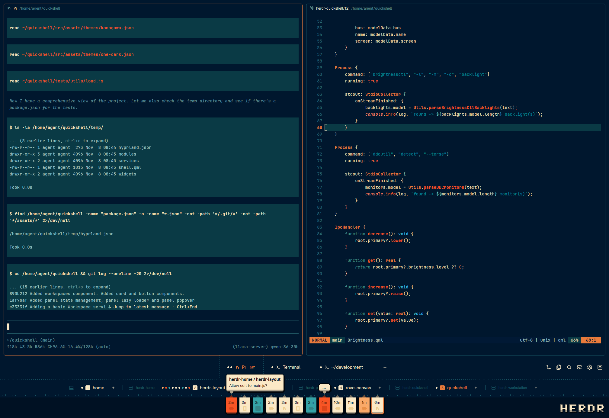

# Docket

A layout for [Herdr App](https://herdr.dev). Dockets come in, you check the work. Inspired by Omarchy Retro 82 and your local chip shop.

## Features

- **Agent flags.** Every agent on every machine, helpers included, hangs from a ruler as a pixel-art flag in its status colour: amber when working, red-orange (pulsing) when it needs you, teal when done and cream when idle. Click a flag to jump to that agent's pane. The focused agent's flag is outlined.
- **Speech bubbles.** An agent that needs you says what it wants in a pixel speech bubble above its flag, with its machine and space in bold. If several are waiting, the one that's waited longest gets the bubble and the rest show "…" until you hover over them.
- **Done stays done.** A finished agent stays teal until you actually open it, so nothing slips past while you're in another tab.
- **Tabs row.** Each tab shows a status dot per pane, the program's icon, its name, and how long since its agent last changed. When there are too many to fit, tabs shrink to a number, and the row scrolls.
- **Spaces row.** Spaces are grouped by machine, each with its agents' status dots and a numbered badge. You can drag to reorder, and there's a **+** per machine.
- **Changes and Files.** Side panels showing the focused folder's git changes (with a diff and a commit box) and its files.
- **Docket Sunset theme.** Deep navy, cream and burnt orange. The dock is drawn entirely from theme tokens, so it follows any theme you pick.

## Install

Ask your Herdr agent to add `herdr.dev/layouts/rove-digital/herdr-docket`.

To install by hand, copy `layouts/Docket.json`, `layouts/Docket.svg`, `themes/Docket-Sunset.json` and the three `mods/docket*` folders into `~/.config/herdr-app/`, and merge `keys.json` into yours. Then pick **Docket** in Settings → Look.

## Keys

| Key | Does |
| --- | --- |
| `ctrl-shift-b` | Collapse or expand the dock (in this layout only) |
| Mouse wheel on the tabs | Next or previous tab |
| Double-click a tab | Rename it |
| Right-click a tab or space | Herdr's tab or space menu |

## What it runs

- `docket-changes`: `git status`, `git diff` and `git rev-parse` in the focused pane's folder, and it watches that folder for changes (`watchFolder`). Pressing **Commit** runs `git add -A` and `git commit -m`.
- `docket-files`: lists folders with `sh` (PowerShell on Windows), runs `git status` for the change marks, and reads files for the preview.
- `docket`: no programs. It only uses Herdr's own commands.

No network requests.

## Credits and license

- `docket-changes` and `docket-files` start from Herdr App's shipped `changes` and `files` mods.
- Pane headers use the shipped `pane` mod.
- The icons are from [Lucide](https://lucide.dev) (ISC License, Copyright (c) Lucide Contributors).

Licensed under [Apache-2.0](LICENSE), as Herdr App is.

[RECIPE.md](RECIPE.md) describes the full build.
