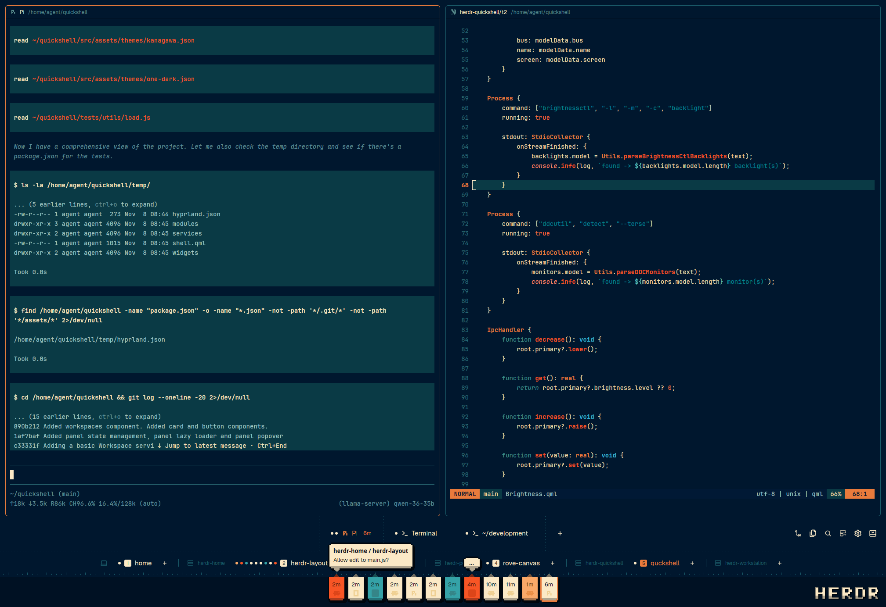

# Docket

Dockets come in, you check the work. Your panes fill the window, and a dock along the bottom keeps the jobs lined up. It shows the tabs in the space you're in, then every space grouped by the machine it runs on. Agent's hang a docket on the rail: amber while it's cooking, red when it needs you, teal when it's ready and cream once it's been picked up. Click a docket to go straight to that agent. When one needs you it pipes up in a speech bubble saying what it's after; if a few are shouting at once, the one that's waited longest gets heard. Inspired by Omarchy Retro 82 and your local chip shop.

## What you see

Top to bottom, at a 2560 px wide window:

- **Top gap.** A 12 px empty row in the theme's `chrome` colour (`#00060d`).
- **Work row.** This row can be resized.
  - **Panes**:
    - The panes of the active tab, with 12 px padding left and right, 12 px gaps, radius 6 and a 1 px border in `input` (`#1a5a68`).
    - The focused pane's border is `ansi3`, burnt orange (`#e97b3c`).
    - Each pane has a 30 px header on top from Herdr's shipped `pane` mod, always shown, even for a lone pane.
  - **Files** (`docket-files`):
    - 320 px wide (240–900), hidden at start.
    - A card with radius 6 and a 1 px `input` outline on `background` (`#00172e`).
    - A 42 px header reading "Files" with the current folder's name on the right.
    - A lazy file tree for the focused pane's folder, with git marks (A in `ansi2` teal; M, D and U in red-orange).
    - Clicking a file shows a read-only, syntax-coloured preview, with "←" to go back.
  - **Changes** (`docket-changes`):
    - 368 px wide (280–900), shown at start. Same card style as Files.
    - A header reading "Changes", a "N files" pill and the total +adds / −deletes.
    - A file list (up to 200 px tall) with a status letter, a dimmed folder and the name, then `+n −n`.
    - A diff of the picked file, with line numbers and faint teal (`ansi2`) or red (`ansi1`) row tints. The first file is open by default.
    - At the bottom, a "Commit message" field and a **Commit** button: `solid` burnt orange when enabled, `raised` when not.
- **Tabs row**, 79 px, on `background`:
  - The tabs and their **+** are centred on the window, so they line up with the spaces and flags below. When the toolbar on the right would be in the way they move left just far enough, and when they overflow they start from the left edge.
  - Each tab is 54 px tall, with 26 px padding each side.
  - Each tab shows:
    - one 6 px status dot per pane, 4 px apart;
    - the lead program's icon at 16 px;
    - its name at 15 px (truncated at 170 px);
    - minutes since its agent last changed at 12.5 px ("1m", "12m", "3h", "2d").
  - The active tab's text and icon are burnt orange; the others are cream (`#fbe9c6`).
  - Every tab sits between vertical dotted dividers, one before the first tab too: 1 px dashes, 1.5 on and 5 off, in `input`, running the full height of the row.
  - A **+** comes after the last tab.
  - On the right is a toolbar of 32 px buttons with 18 px icons, rounded 7, filled with `hover` on hover:
    - **Changes** and **Files**: show or hide those panels, filled with `selected` while the panel is open.
    - **Search**, **Connect a machine** and **Settings**.
    - **Collapse/expand dock**.
  - When the tabs no longer fit, each one goes compact: its dots, its icon and its number, with the name as a tooltip. The strip also scrolls sideways.
- **Spaces row**, 48 px, on `background`:
  - A horizontal dotted rule along the top, styled like the dividers, with 8 px of space below it.
  - The groups are centred on the window, with 16 px padding each side.
  - Spaces are grouped by machine: this computer first (laptop icon), then each connected machine by name (server icon plus its name at 11.5 px). Icons and machine names are in `input`. A machine shows even if it has no spaces.
  - Each space shows:
    - one 6 px dot per agent in the space, in the agent's status colour (a single cream dot when there are none);
    - a 16 px rounded square (radius 3) with the space's number at 11 px in `accent_foreground`: cream normally, burnt orange for the active space;
    - its name at 15 px, cream or burnt orange when active.
  - Spaces are 24 px apart. Each group ends with a 26 px **+** (new space on that machine), and a 1×17 px `input` rule separates one group from the next.
- **Agents row**, 80 px:
  - The top 12 px is a strip in `background`. Below it the bar is `raised` (`#001123`).
  - **Ruler.** A ruler sits along the strip: 1 px ticks in `input`, every fourth one tall (5.5 px) and the rest short (2.5 px), ending 5 px above the bar. A tall tick lines up with every flag's arrow.
  - **Flags.** One flag per agent, including paneless helpers, newest on the left. The row of flags is centred on the window, never starting less than 18 px in and always stopping short of the wordmark:
    - Each flag is 41 px wide and 56 px tall, 3 px apart, built from 3 px "block pixels".
    - A small stepped arrow (7 px) sits on the ruler, coloured 45% from `chrome` toward the status colour.
    - The body is the status colour inside a dark (`chrome`) outline, with a 3 px drop shadow down-right, stepped bottom corners and a 6 px bottom band 30% darker.
    - On the face is the time since its last status change at 13 px, with the program icon (17 px) below it. Both are a deeper shade of the flag's own colour; an idle flag's time is `accent_foreground`.
  - **Status colours**:

    | Status | Colour |
    |---|---|
    | working | `#faa968` amber |
    | blocked (needs you) | `#f85525` red-orange |
    | done | `#35a2a7` teal |
    | idle | `#fbe9c6` cream |

  - **Focused flag.** The agent in the focused pane gets its outline in cream instead of `chrome`, or burnt orange when the flag itself is cream (idle).
  - **Speech bubbles.** A blocked agent gets a bubble above its flag, built from the same 3 px block pixels:
    - Cream (`foreground`) inside a `chrome` outline with rounded ends (corners stepped in two blocks), a 3 px drop shadow down-right and a bottom band 30% darker.
    - A small stepped tail (8 px then 4 px wide, 4 px long) in the band's colour, coming out of the bubble's bottom-left 20 px in. Its tip sits 6 px above the tip of the flag's arrow.
    - Inside, at 13 px in `accent_foreground`: the agent's machine and space on their own line in bold Noto Sans, as "machine / space" (just the space for this computer), then the agent's own status message (or "Needs you").
    - The bubble runs out to the right, or to the left when it wouldn't fit to the right and there's more room on the left. The message folds onto a second line at about 60 characters (415 px), or sooner if the window is narrow, and is cut short with "…" so it never goes past two lines (140 characters at most).
    - Only one bubble is open at a time. Every other blocked flag shows a closed bubble exactly the flag's width with a bold "…" inside and its tail over the arrow.
  - **Wordmark.** HERDR in a 6×7 pixel font with 2 empty cells between letters:
    - Scaled to half the bar's height under the strip, 14 px from the right edge and 2 px below centre.
    - Cream letters with the bottom 2 rows 30% darker.
    - A `chrome` drop shadow half a letter-pixel down and to the right.
    - A 2 px inset shadow along each letter's top and left edges, 45% toward `chrome`.

## How it behaves

- **Statuses:**
  - **working**: an amber flag. The face and icon pulse slightly darker (a `chrome` wash between 0 and 20% opacity, every 2.4 s).
  - **blocked**: a red-orange flag that pulses the same way.
  - **done**: a teal flag. Herdr turns `done` into `idle` as soon as you look at the tab. Docket keeps it done until you actually open that agent, by clicking its flag or focusing its pane. It does the same for helpers, which never report done themselves.
  - **idle**: a cream flag.
  - Tab and space dots use the same colours.
- **Flag clicks.** Clicking a flag always takes you to the agent: it focuses its pane (`pane.focus`), or peeks a paneless helper (`terminal.peek`), and marks it seen. The tooltip reads "Program · space · status" (blocked flags have their bubble instead).
- **Speech bubbles:**
  - The open bubble belongs to the blocked flag under the pointer; failing that, to the blocked agent in the focused pane; failing that, to the one that's been waiting on you longest and that you haven't opened since it started waiting.
  - Hovering a flag with a closed bubble opens it. Moving off closes it again, after a 250 ms grace so you can move onto the bubble.
  - Once you've opened an agent and moved on, its bubble closes up and the next one waiting gets heard. If it gets blocked again later, it speaks up again.
  - Clicking a bubble does the same as clicking its flag.
- **Flag motion:**
  - A new agent slides in from past the left edge (600 ms, ease-out). The others shift right in a ripple, 35 ms apart, each taking 380 ms.
  - Several agents arriving together come in one at a time, 280 ms apart.
  - A closed agent fades out where it stood (300 ms) and the rest close up.
  - When the flags don't fit, they overlap, with older ones underneath, down to 10 px apart. The ruler's spacing closes up with them.
  - The order is kept across restarts.
- **Tabs:**
  - Click to select. Double-click to rename. Drag to reorder (a 2 px `accent` bar marks the drop point).
  - Right-click for the shipped tab menu.
  - The mouse wheel steps through tabs.
  - New tabs always go to the end of the list.
  - **+** opens the shipped `new-menu`.
- **Spaces:**
  - Click to select. Drag to reorder within the same machine.
  - Right-click for the shipped space menu (rename, worktrees, close).
  - The group's **+** makes a new space on that machine.
- **Toolbar:**
  - Changes and Files run `layout.toggle` on `docket-changes` / `docket-files`.
  - Search runs `app.palette`, Connect a machine runs `mod.open machine-add`, and Settings runs `app.settings`.
- **Collapsing the dock.** Collapse, or **Ctrl+Shift+B** in this layout, runs `layout.toggle` on `docket-lower`, the column holding the spaces and agents rows. The tabs row stays.
- **Times** update on the minute, so every row agrees.
- **Changes panel.** Follows the focused pane's folder and refreshes when files change. Commit runs `git add -A` and then `git commit -m`.
- **Files panel.** Follows the focused pane's folder and keeps each folder's open subfolders and file (the last 50 folders).
- **Other themes.** Everything is drawn from theme tokens, so picking another theme recolours the whole dock.

## Built from

- **`layouts/Docket.json`** is a root `column`:
  - `top-gap`: a 12 px row.
  - `work`: a resizable row of three blocks:
    - `main`: the active tab's panes with the pane options above;
    - `docket-files`: hidden, 320 px;
    - `docket-changes`: 368 px.
  - A block running the `docket` mod with `props.part` set to `"tabs"` (79 px).
  - `docket-lower`: a 128 px column holding two more `docket` blocks, `"spaces"` (48 px) and `"agents"` (80 px), so one `layout.toggle` collapses both.
  - Root settings: `"theme": "Docket-Sunset"` and `"preview": "layouts/Docket.svg"`.
- **`themes/Docket-Sunset.json`** defines:
  - `background #00172e`, `foreground #fbe9c6`;
  - `chrome`/`canvas #00060d`, `raised #001123`, `input #1a5a68`;
  - `accent`/`solid`/`ansi3 #e97b3c`, `accent_foreground #000c17`;
  - the four status colours listed above, and a matching 16-colour ANSI set.
- **`mods/docket`** is one view whose `props().part` decides which row it draws.
  - It uses these `herdr` functions:
    - for data: `agents()`, `terminals()` (for helpers, and each agent's status message in `report.msg`), `spaces()`, `machines()`, `panes()` and `focused()`;
    - for actions: `run()`, `openOverlay()` and `setAgentOrder()`;
    - for state and layout: `shared()`/`setShared()` (`docket.changed` holds status-change times, `docket.seen` when each agent was opened), `layout()` and `theme()`.
  - Flag order is kept in `localStorage`.
  - The ruler, the dotted rule, the tab dividers and the wordmark are each one `window.paint_path` path made with `PathBuilder`, cached until their size changes.
  - The speech bubbles are `Popup`s from `gpui-base`, each pinned to a 1 px mark on its flag, so they draw above every row and stay inside the window.
  - Its icons are Lucide SVGs (ISC, licence included).
- **`mods/docket-changes`** and **`mods/docket-files`** are restyled copies of Herdr's Changes and Files panels. They use `exec`, `readTextFile` and `watchFolder`.
- **Shipped pieces used:**
  - the `pane` mod (pane headers), `menu`, `new-menu` and `machine-add`;
  - the icons `mods/files/*.svg` and `mods/workspace-chrome/files.svg`.
- **Programs run:** `git`, via the Changes and Files panels: status, diff, and `add`/`commit` when you press Commit. Files also runs `sh`, or PowerShell on Windows, to list folders. Nothing reaches the network.
- **`keys.json`** adds `"layout:Docket": { "ctrl-shift-b": "layout.toggle:docket-lower" }`.
- **Fonts:** the bubbles' bold uses Noto Sans. Herdr's UI font, Geist, may only draw one weight (a variable font), so bold in it can come out regular.

## Watch out

- **No key-command loops.** A mod that waits on `nextCommand()` leaves a waiting copy behind every time its file is saved, because commands only reach the copy on screen. They pile up until the window freezes on reload and rows show "interrupted". So Ctrl+Shift+B is a plain `layout.toggle` in `keys.json` rather than a command to the mod.
- **Status messages are base64.** An agent sends its message in OSC 7501 as `msg=` with the text base64-encoded, for example `state=blocked:app=x:msg=<base64>`. Plain text is dropped.
- **A tooltip blocks hover.** With a tooltip on a flag, hovering it didn't open the bubble, so blocked flags don't have one.
- **`line_height` takes a multiple, not px.** `line_height(18)` makes lines 18 times the text size. The bubble leaves it at the default.
- **Vertical percentages in paths.** A path's `"100%"` works across but draws nothing going down. The tab divider is therefore a fixed 200 px line inside a 1 px wide, full-height box with `overflow_hidden`.
- **Overlapping shapes in a fill path cancel out** and leave holes. The wordmark's left and top inset shadows overlap at each letter's top-left corner, so they are separate paths.
- **Only the tabs copy writes shared state.** It is never hidden, so it writes `docket.changed`. The other copies only read, so every row shows the same times.
- **Remote ids need a prefix.** A remote core's helper labels and parents don't carry the `machine/` prefix that app ids have, so add it before matching.
- **Flag spacing.** Flags step 44 px (41 + 3) and the ruler's ticks are 11 px apart. The ruler is anchored on the first flag's arrow, wherever the centred row starts, so the tall ticks sit under every arrow.
- **Compact tabs** kick in when the measured labels would run into the toolbar. Each label's width is remembered once it has been measured, so the switch doesn't flicker.
- **Ctrl+Shift+B** normally toggles the sidebar. Docket rebinds it only inside the `layout:Docket` section.

## Done when

- Three dock rows appear under the panes (79, 48 and 80 px), along with a Changes panel on the right, all in navy, cream and burnt orange.
- Starting an agent slides a flag in from the left. It turns amber while working, red-orange and pulsing when it asks a question, and teal when it finishes in another tab. It stays teal until you click it, then turns cream.
- A blocked agent gets a cream speech bubble with its machine and space in bold and its question underneath, the tail's tip just above the flag's arrow. With two or more blocked, one bubble is open and the others show "…"; hovering one opens it, and moving off closes it.
- The tabs, spaces and flags are centred on the window.
- Focusing an agent's pane outlines its flag, in cream or (on a cream flag) burnt orange.
- Each space shows one dot per agent and a numbered square that turns burnt orange when that space is active.
- The HERDR wordmark sits at the bar's right edge with no specks at its letters' corners.
- With many tabs, the tabs go compact and the strip scrolls.
- Ctrl+Shift+B collapses the dock to the tabs row and brings it back.
- Changes lists the focused repo's edits, shows a diff and commits.
- `herdr-app check` passes for all three mods, and `layout.switch {"name": "Docket"}` loads the layout with no errors in `herdr-app status`.
